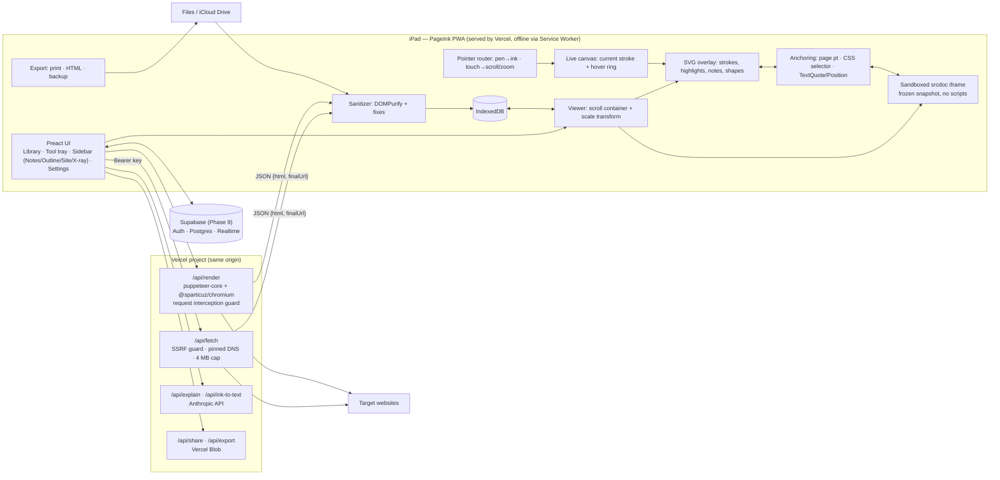

# PageInk — Build Plan

Working name: **PageInk** (rename freely in P0.1).
PageInk is an iPad-first PWA. You import a web page or a whole site, then mark it up directly with Apple Pencil: ink, highlighter, notes, shapes and eraser. The aim is to work out how the page is built and why it works, without taking screenshots. It grows into a polished study and review tool: X-ray inspection, AI "explain this" callouts, a time machine and shared boards.

> **How to use this file (implementing model):**
> - Do the phases in order, and the tasks inside a phase in order.
> - Each task names the files it touches and its acceptance criteria (AC). A task is done only when every AC passes.
> - Do not add features, libraries or abstractions that a task does not ask for.
> - **SPIKE** tasks: build the smallest throwaway version, record the outcome in `docs/DECISIONS.md`, then take the branch that outcome selects.
> - Every open question already has a default (§9). Never stop to ask; use the default and note it in the commit.
> - If you are stuck twice on the same task, escalate (§10).

---

## 1. Vision & user stories

**Vision:** "Safari's Markup, on the real page, and it never goes away." You open a page and pick up the Pencil, and the page becomes your whiteboard. Fingers scroll and zoom; the Pencil draws. Marks stay attached to the right words and boxes. Tap X-ray and the page shows how it is built. Circle something and ask Claude what it does. Everything works offline and everything exports. Later you can share a board and review a page together.

User stories (iPad + Apple Pencil, any orientation, Split View friendly):

1. **Import by URL.** I paste a URL and get a faithful copy within about 5 s. JavaScript-heavy apps are rendered automatically. The copy works offline.
2. **Import anything else.** I can import a saved `.html` file, a PDF, or the page I am looking at in Safari (bookmarklet), including pages behind a login.
3. **Draw naturally.** Pressure-sensitive ink with no visible lag. Palm and fingers never draw; one finger scrolls and two fingers pinch-zoom, even in markup mode.
4. **Highlight text.** A quick highlighter swipe snaps to the exact words, and the highlight survives zoom, rotation and Split View.
5. **Write notes.** I tap an element and write in a sticky note; Scribble turns my handwriting into text. I can also turn any handwritten ink into text.
6. **Shapes.** I hold the Pencil at the end of a stroke and it snaps to a line, arrow, rectangle or ellipse.
7. **Erase, undo, lasso.** Erase strokes, undo and redo anything, and lasso to move, recolour or tag.
8. **Understand structure.** X-ray shows each element's tag, classes, box, font and colours; Structure shows landmarks and headings; Outline lists the sections.
9. **Ask Claude.** I circle a region and get an "Explain this" callout pinned to it: what it does, how it is probably built, and UX notes.
10. **Find again.** A library of sites and pages, tags, and full-text search across all notes. Templates for UX audit, SEO and learning.
11. **Time machine.** I replay how I annotated, re-capture a page, see what changed, and my notes follow the content.
12. **Share.** I export an annotated PDF/PNG/HTML, send a read-only link, or open a live board where a friend draws with me.
13. **Delight.** It feels like a native Apple app: smooth motion, a beautiful tool tray, sensible gestures, dark mode, and onboarding that teaches the gestures in 30 seconds.

---

## 2. Key decisions

### 2.1 Hosting comparison (the big one)

| | **Vercel Hobby (chosen)** | GitHub Pages | Cloudflare Pages + Workers |
|---|---|---|---|
| Static hosting | Yes; Git push deploys, plus a **preview URL per branch/PR** (great for testing on the iPad) | Yes (needs a public repo on the Free plan) | Yes |
| Server code in the same project | **Yes: `/api/*` Vercel Functions** (Node.js, same origin, so no CORS) | **No** (static only) | Yes (Workers / Pages Functions) |
| Function limits (free) | **300 s max duration, 2 GB RAM / 1 vCPU**; 1M invocations, **4 h Active CPU**, 360 GB-hrs memory, 100 GB transfer per month; **4.5 MB request/response body** | n/a | 100k req/day, **10 ms CPU per request**, 128 MB memory |
| Headless browser | **Feasible**: `puppeteer-core` + `@sparticuz/chromium(-min)` fits the 250 MB unzipped function limit; Vercel publishes a template | Impossible | Only via Browser Rendering: **10 browser-min/day free** |
| Storage | Vercel Blob (free on Hobby within limits); Postgres/Redis via Marketplace (Neon, Upstash) | none | KV / D1 / R2 (R2 10 GB free) |
| Custom HTTP headers (real CSP, frame-ancestors) | Yes (`vercel.json`) | No (meta-tag CSP only) | Yes |
| Gotchas | **Non-commercial use only** on Hobby; exceeding a limit **pauses** the feature (no bill, but up to a 30-day wait); can't connect repos owned by a GitHub *organization* | Public repo; no server | 10 ms CPU makes HTML processing tight; headless needs the paid plan for real use |

**Choice:** GitHub is the source repo and runs CI (tests in GitHub Actions). **Vercel deploys everything as one project**: the static PWA plus Node functions `/api/fetch`, `/api/render`, `/api/explain`, `/api/share`, `/api/export`. Vercel's 300 s / 2 GB functions make server-side headless rendering realistic for free, which upgrades the core experience: JS-heavy pages work in the MVP. Hobby pauses rather than bills, so the worst case is a paused feature, never a surprise invoice. **Plan B** (documented in Appendix A) is Cloudflare Workers for fetching, if Vercel limits ever bite.

### 2.2 Decision table

| # | Decision | Options | Choice | Why |
|---|---|---|---|---|
| D1 | **How a URL becomes an annotatable page** | (a) fetch-proxy, (b) headless snapshot, (c) client import of HTML/PDF, (d) bookmarklet | **Tiered automatic pipeline**: `/api/fetch` (fast raw HTML) → if the sanitized text is under 200 chars or a `<div id=root|app|__next>` is empty, call `/api/render` (headless Chromium, waits for network idle, returns the serialized DOM). Plus (c) file import in the MVP, and (d) a bookmarklet in V1 for logged-in pages. The result is always a **sanitized, frozen snapshot** in IndexedDB, rendered in a **sandboxed `srcdoc` iframe** (`sandbox="allow-same-origin"`, never `allow-scripts`). | Most sites block iframing (X-Frame-Options / `frame-ancestors`) and cross-origin DOM can't be read, so live embedding is impossible. A snapshot is same-origin, so we can read its DOM for anchoring and X-ray. It is frozen, so anchors stay stable. And it is inert, so it is safe. Fetch is cheap; render costs Active CPU (4 h/month), so it only runs when needed. |
| D2 | Share-sheet import / MHTML / screenshot-only | | **Cut** | iOS has no Web Share Target for PWAs (WebKit bug 194593, open since 2019). iPad Safari can't save MHTML usefully. Screenshots lose text, so anchoring would be impossible. |
| D3 | **Layout stability** | reflow to iPad width vs. freeze width | **Freeze `layoutWidth` per page** (default 1280; "Tablet 820" and "Phone 390" presets). The whole view is scaled with a CSS transform. | Rotation, zoom and Split View never reflow the page, so stored coordinates never move. This removes most anchoring bugs. Presets also allow responsive comparison (V1). |
| D4 | **Anchoring** | page coords; W3C TextQuote/TextPosition; element-relative | **Hybrid per type.** Ink/shapes: page coords (primary) plus element CSS selector and relative offset (secondary, used when re-capturing). Highlights: TextQuote + TextPosition (primary) plus cached rects. Notes: element selector → TextQuote → page point. | Ink often isn't on text, and page coords are exact on a frozen layout. Highlights must survive re-capture. Notes belong to elements. Every annotation keeps a page point, so nothing is ever lost (orphans are rendered at that point). |
| D5 | **Ink rendering** | one giant canvas; SVG; tiles | **Committed strokes = SVG paths** in an overlay sized to the document. **The live stroke = a viewport-sized canvas.** | iOS caps a single canvas at about 16.7 M px, so a tall page can't be one canvas. SVG stays crisp at any zoom, exports as vectors and hit-tests for free. |
| D6 | Stroke geometry | custom vs. library | **perfect-freehand** | A tiny, proven pressure-to-outline function. |
| D7 | **Stack** | React/Svelte/vanilla | **Vite + TypeScript + Preact + @preact/signals** (UI chrome); vanilla TS for ink/viewer/anchoring; `idb`, `dompurify`, `vite-plugin-pwa` (Workbox); Vitest + Playwright. Functions: TypeScript in `/api` using the Vercel Node runtime, `undici`, `puppeteer-core`, `@sparticuz/chromium`, `@anthropic-ai/sdk`, `@vercel/blob`. | Boring and widely known by cheaper models. The pen hot path has no framework in it. |
| D8 | **Local storage** | | **IndexedDB (offline-first)** + "Back up to Files" (`.pageink.json` into iCloud Drive) + `navigator.storage.persist()` | You own the data; iCloud syncs your backups for free; it protects against Safari storage eviction. |
| D9 | **Cloud storage** | Vercel Blob, Upstash Redis, Neon Postgres, Supabase, Cloudflare D1/R2, GitHub Gist | **Vercel Blob** for read-only share links and export files (V1; same project, no extra account). **Supabase** (Auth + Postgres + Realtime + Storage) for **live collaborative boards** (Phase 9 only). | Blob is enough for immutable shares. Live multi-user boards need auth, a database and realtime pub/sub; Vercel Functions can't hold WebSockets, so polling would eat invocations. Supabase bundles all four on one free tier (pauses after inactivity; acceptable for personal use). |
| D10 | **Proxy abuse prevention** | CORS, Turnstile, personal key | **Personal key** (env `APP_KEY`, typed once in Settings and sent as `Authorization: Bearer`), plus SSRF guard with **pinned DNS**, size/time caps, and JSON-only responses. Phase 9 replaces this with Supabase auth for signed-in users. | Single user; a static bundle can't hide a secret, so the key lives on the device. Hobby pausing caps the blast radius. |
| D11 | **Export** | client canvas, print, server Chromium | **MVP:** client `print()` → PDF (works offline), standalone HTML, JSON backup. **V1:** `/api/export` uses server Chromium `page.pdf()` / full-page screenshot for pixel-perfect PDF/PNG, flattened or with layers (via Blob upload if over 4.5 MB). | Print needs no server. Server Chromium avoids canvas-taint and iOS print quirks. |
| D12 | Handwriting → text | build HTR / Scribble / LLM vision | **Scribble** in note fields (MVP, free, on-device) + **"Convert ink to text"** via Claude vision on a lasso (Phase 7) | Scribble is native-quality; Claude handles freeform diagrams and labels. |
| D13 | AI | provider | **Anthropic Messages API via `/api/explain`**; key in a Vercel env var; per-day cap; model id looked up from current docs at build time | The key never reaches the client; the cost cap lives in the Anthropic console. |
| D14 | Repo visibility | | **Private GitHub repo under your personal account** | Vercel Hobby deploys private personal repos; Pages no longer forces public. |

---

## 3. Architecture & data model

### 3.1 Diagram



Viewer stack, bottom to top: `iframe` (receives pointer events only in Reading mode), then the `svg` overlay, then the `canvas` live layer (pointer-events none; input is captured on the overlay container).

**Coordinate rule (memorise it):** all stored geometry is in **document space**: CSS px of the snapshot at its `layoutWidth`, with the origin at the top-left of the snapshot document. `docX = (clientX − contentRect.left) / scale`, and likewise for y. Zoom changes only `scale`.

### 3.2 Repository layout (one Vercel project at repo root)

```
/
  PLAN.md  README.md  docs/DECISIONS.md  docs/IPAD-CHECKLIST.md
  package.json  vite.config.ts  tsconfig.json  vercel.json  index.html  .env.example
  .github/workflows/ci.yml          lint + unit + Playwright on every push/PR
  public/icons/  public/splash/  public/sample/sample-page.html
  api/                              Vercel Functions (each file = one route)
    fetch.ts  render.ts  explain.ts  ink-to-text.ts  share.ts  export.ts
    _lib/guard.ts  _lib/auth.ts  _lib/limits.ts  _lib/safe-fetch.ts   (underscore = not a route)
  src/
    main.tsx
    ui/        App.tsx ToolTray.tsx Library.tsx Sidebar.tsx NotesPanel.tsx Settings.tsx Note.tsx Onboarding.tsx
    viewer/    viewer.ts coords.ts zoom.ts
    ink/       pointer.ts live-canvas.ts stroke.ts eraser.ts history.ts shapes.ts snap-text.ts lasso.ts
    anchor/    text-quote.ts css-selector.ts anchor.ts
    import/    sanitize.ts import-url.ts file-import.ts pdf-import.ts receive.ts
    store/     db.ts repo.ts backup.ts schema.ts
    export/    print.ts standalone.ts
    xray/      xray.ts
    ai/        explain.ts
    time/      replay.ts compare.ts
    boards/    supabase.ts sync.ts presence.ts
    templates/ ux-audit.json seo.json learning.json
    debug/     pen-log.ts
  test/   *.test.ts  fixtures/
  e2e/    *.spec.ts
```

### 3.3 Data model (`src/store/schema.ts`)

IndexedDB database `pageink`, version 1. Stores: `pages` (key `id`; indexes `siteOrigin`, `updatedAt`), `snapshots` (key `pageId`), `annotations` (key `id`; index `pageId`), `blobs` (key `id`; voice notes and images), `settings` (key `key`). Schema migrations go in `db.ts` `upgrade()` keyed by version; never delete user data in a migration.

```ts
type ID = string;  type ISO = string;   // crypto.randomUUID(), new Date().toISOString()

interface Page {
  id: ID; schemaVersion: 1;
  url: string;                 // final URL after redirects ('' for files)
  siteOrigin: string;          // new URL(url).origin | 'file:' | 'pdf:'
  title: string;
  captureMethod: 'fetch' | 'render' | 'file' | 'bookmarklet' | 'pdf';
  capturedAt: ISO;
  layoutWidth: number;         // FROZEN after import
  docHeight: number;
  textHash: string;            // SHA-256 of body text, for change detection
  versionOf?: ID;              // Phase 8: re-captures point to the first version
  tags: string[];
  template?: 'ux-audit' | 'seo' | 'learning';
  checklist?: Record<string, boolean>;
  boardId?: string;            // Phase 9
  createdAt: ISO; updatedAt: ISO;
}

interface Snapshot { pageId: ID; html: string /* sanitized, with <base> */; sanitizerVersion: number }

interface Anchor {
  page: { x: number; y: number };                      // always present, doc space
  element?: { css: string; rx: number; ry: number };   // rx/ry: 0..1 inside element box
  text?: {
    quote: { exact: string; prefix: string; suffix: string };   // W3C TextQuoteSelector (32-char context)
    position: { start: number; end: number };                    // W3C TextPositionSelector over body text
  };
}

interface Annotation {
  id: ID; pageId: ID;
  kind: 'ink' | 'highlight' | 'note' | 'shape' | 'ai';
  layer: 'ink' | 'highlights' | 'notes' | 'ai';
  color: string;
  anchor: Anchor;
  createdAt: ISO; updatedAt: ISO; author?: string;    // author = Supabase user id in boards
  deleted?: true;                                      // soft delete: undo + sync
  orphaned?: true;                                     // re-anchoring failed; drawn dashed at anchor.page
  ink?: Stroke;
  shape?: { type: 'line' | 'arrow' | 'rect' | 'ellipse'; x1: number; y1: number; x2: number; y2: number; stroke: number };
  highlight?: { rects: Rect[] };                       // cache; recomputed from text anchor on load
  note?: { text: string; collapsed: boolean; voiceBlobId?: ID };
  ai?: { prompt: string; answer: string; model: string; regionPng?: ID };
  tags?: string[];
  card?: { box: 1 | 2 | 3 | 4 | 5; due: ISO };         // flashcards (Learning template)
}

interface Stroke {
  tool: 'pen' | 'highlighter' | 'marker';
  size: number;                // base width, doc px
  points: number[];            // flat [dx,dy,pressure,tMs,...] RELATIVE to anchor.page
  path?: string;               // cached SVG 'd' (regenerable)
  bbox: Rect;
}
interface Rect { x: number; y: number; w: number; h: number }
```

Backup file: `{ "format":"pageink-backup", "version":1, "exportedAt":ISO, "pages":[], "snapshots":[], "annotations":[], "blobs":[{id,type,base64}] }`.

Supabase tables (Phase 9) mirror `pages`, `snapshots` (stored in Supabase Storage) and `annotations`, plus `boards(id, owner, title, created_at)` and `board_members(board_id, user_id, role: 'owner'|'editor'|'viewer')`, with Row-Level Security on membership.

---

## 4. Feature tiers

### Core MVP (Phases 0–4)
- Library grouped by site; rename, delete; storage meter.
- Import: URL with automatic fetch → render fallback; `.html` file; sample page on first run.
- Reading / Markup mode toggle.
- Pen (pressure), highlighter (multiply blend), 8-colour palette + custom, 3 sizes; stroke eraser; undo/redo (also two-finger tap = undo, three-finger tap = redo).
- Palm rejection; finger scroll and pinch-zoom; "Draw with finger" option.
- Text-highlight tool (word-exact); sticky notes anchored to elements with Scribble; notes sidebar with jump-to; layer visibility.
- Offline PWA; autosave; backup/restore to Files; export PDF (print), standalone HTML.
- `?debug=1` pen diagnostics (no Mac needed).

### V1 (Phases 5–6)
- Highlighter → text snap; shape snap (hold); lasso select/move/recolour/tag/delete.
- **X-ray inspect** (tag, classes, box model, font, colours, contrast ratio, link target, selector) + **Structure overlay** (landmarks, headings, forms, images without alt) + **Outline** + **Site map**.
- Responsive peek: re-render the same URL at 390 / 820 / 1280 and flip between them (each is its own page version).
- Follow link → import into the same site.
- Tags + global search; templates (UX audit, SEO, Learning) with checklists and colour legends.
- Dark-mode rendering; Pencil hover ring; PDF import; bookmarklet capture; pixel-perfect PDF/PNG export (server Chromium); read-only share links.

### Wild (Phases 7–9): bold but buildable
- **Explain this**: lasso a region; Claude gets the cropped image plus the DOM snippet and returns a pinned callout (what it does, likely implementation, UX critique). Follow-up chat in the callout.
- **Ask the page**: a chat sidebar grounded in the snapshot text, plus your notes ("What does this pricing page hide?"). Answers cite and jump to passages.
- **AI outline & summaries**: a one-line summary per section, plus a "how this page persuades" teardown that auto-creates notes on the hero, CTA and social proof.
- **Ink → text**: lasso handwriting or diagram labels and convert to a typed note (Claude vision).
- **Replay timeline**: scrub or play your annotation session (strokes carry timestamps).
- **Version compare**: re-capture, side-by-side or swipe diff, a changed-text list, annotations carried over by fuzzy re-anchoring.
- **Watch a page**: "re-capture weekly" reminder plus diff badge (manual trigger on open; no background jobs on iOS).
- **Flashcards** from highlights (Leitner boxes), **voice notes** pinned to elements.
- **Collaborative boards**: invite by link, live strokes and cursors with names, comment threads on notes, per-person colours, presence avatars, viewer/editor roles.
- **Review mode**: a "presenter" laser pointer (fading ink) and a step-through of notes, for walking someone through a page on a call or AirPlay.

### Explicitly cut
- Running the site's live JavaScript (unsafe, and blocked by framing).
- Pencil double-tap / squeeze / barrel-roll (not exposed to Safari web content).
- Haptics (the Vibration API is unsupported in iOS Safari).
- Share-sheet target (D2).
- Background page monitoring (no reliable background execution for iOS PWAs).
- Our own HTR model (Scribble + Claude cover it).
- Commercial or multi-tenant SaaS features (Hobby plan is non-commercial).

---

## 5. Phased roadmap

**Conventions:** run all commands at the repo root. `npm run lint` is `tsc --noEmit`; `npm test` is Vitest. Each task ends with both passing and a commit `P<phase>.<task>: <summary>` on a branch `phase-<n>`. Open a PR when the phase is done: Vercel posts a **preview URL**, which the user tests on the iPad; then merge to `main` (production).

### Phase 0 — Repo, Vercel deploy, installable PWA
**Goal:** a real (empty) app is live on Vercel from GitHub and installs to the iPad.

| # | Task | Files | Acceptance criteria |
|---|---|---|---|
| P0.1 | `git init`, `README.md` (one paragraph + link to PLAN.md), `.gitignore` (node_modules, dist, .vercel, .env*, `*.pageink.json`), `docs/DECISIONS.md` with D1–D14 as one line each, `.env.example` listing `APP_KEY=`, `ANTHROPIC_API_KEY=`, `BLOB_READ_WRITE_TOKEN=`, `VITE_SUPABASE_URL=`, `VITE_SUPABASE_ANON_KEY=` (all empty). | root | `git status` is clean; no secrets are tracked. |
| P0.2 | Scaffold with `npm create vite@latest . -- --template preact-ts`; remove the demo content; add scripts `lint`, `test` (`vitest run`), `e2e` (`playwright test`); add `test/smoke.test.ts`. | package.json, src/* | `npm run dev` shows "PageInk"; `npm test` passes. |
| P0.3 | `api/health.ts`: `export default function handler(req, res) { res.json({ ok: true }) }` (Vercel Node signature; add `@vercel/node` types). `vercel.json`: `{"framework":"vite","functions":{"api/render.ts":{"maxDuration":60,"memory":2048},"api/**/*.ts":{"maxDuration":20}}}`, plus `headers` (P0.5). | api/health.ts, vercel.json | `npx vercel dev` serves `/api/health` → `{"ok":true}`. |
| P0.4 | PWA: `vite-plugin-pwa` (`registerType:'autoUpdate'`, `navigateFallbackDenylist: [/^\/api\//]`). Manifest: name, short_name, `display:'standalone'`, `orientation:'any'`, theme `#0b0b0f`, background `#0b0b0f`, icons 192/512 + maskable. `index.html`: `apple-touch-icon` 180, `apple-mobile-web-app-capable`, `apple-mobile-web-app-status-bar-style: black-translucent`, viewport `width=device-width, initial-scale=1, viewport-fit=cover`. Temporary icon: a pen nib on a dark rounded square (final art in P10.1). | vite.config.ts, index.html, public/icons/* | The build emits `manifest.webmanifest` and `sw.js`; Lighthouse "installable" passes on the preview. |
| P0.5 | Security headers in `vercel.json` for `/(.*)`: `Content-Security-Policy: default-src 'self'; script-src 'self'; style-src 'self' 'unsafe-inline' https:; img-src 'self' https: http: data: blob:; font-src 'self' https: data:; media-src 'self' blob:; connect-src 'self' https://*.supabase.co wss://*.supabase.co; frame-src 'self' blob:; object-src 'none'; base-uri 'self'; frame-ancestors 'none'`, `X-Content-Type-Options: nosniff`, `Referrer-Policy: strict-origin-when-cross-origin`, `Permissions-Policy: camera=(), geolocation=(), microphone=(self)`. | vercel.json | The preview has no CSP console errors; `curl -I` shows the headers. |
| P0.6 | `ci.yml`: on push and pull_request → checkout → setup-node (LTS, npm cache) → `npm ci` → lint → unit tests → `npx playwright install --with-deps webkit chromium` → `npm run build` → `npm run e2e` (uses `vite preview`). Use the current major versions of the official actions. | .github/workflows/ci.yml | A push makes the CI run green. |
| P0.7 | User: create the repo, import it to Vercel, set branch protection (see §8 steps 1–6). | GitHub/Vercel UI | `https://pageink.vercel.app` (or the assigned name) serves the app; a PR gets a preview URL comment. |

**Done when (iPad):** open the production URL in Safari → Share → Add to Home Screen → launch from the icon. It opens full-screen. Turn on Airplane Mode and relaunch: it still opens.

---

### Phase 1 — Ink on a static page
**Goal:** Pencil ink that feels native, over a bundled sample page, saved locally. This is the riskiest phase, so it starts with a spike.

| # | Task | Files | Acceptance criteria |
|---|---|---|---|
| P1.1 | `public/sample/sample-page.html`: a self-contained article about 6000 px tall (nav, headings, paragraphs, card grid, inline SVG image, a form), no scripts. | public/sample/ | Opens standalone. |
| P1.2 | **Viewer** (`viewer.ts`): scroll container → wrapper (`transform: scale(s)`, `transform-origin:0 0`) → iframe (`sandbox="allow-same-origin"`, `srcdoc`, width = `layoutWidth` 1280, `scrolling="no"`, border 0) + absolutely positioned `<svg>` of the same size. After `load` and again after all `img` load/error, measure `documentElement.scrollHeight` and set the heights. The wrapper's outer size is `layoutWidth*s × docHeight*s`. Initial `s = containerWidth/layoutWidth`; a ResizeObserver refits on rotation or Split View. | src/viewer/viewer.ts, coords.ts | Full width with no horizontal scroll in both orientations. Unit test: `clientToDoc` with scale 0.5, offset (10,20), client (110,220) → (200,400). |
| P1.3 | **Pen debug overlay** `?debug=1`: the last 50 pointer events (type, pointerType, pressure, tiltX/Y, `altitudeAngle`/`azimuthAngle` if present, `getCoalescedEvents?.().length`, `getPredictedEvents?.().length`, buttons) and the move rate in Hz. Lazy-load **eruda** (on-device console) only with `?debug=1`. | src/debug/pen-log.ts | On the iPad, `pen` events show pressure 0–1. Eruda is absent from the main chunk. |
| P1.4 | **SPIKE — input routing and zoom.** Option A: overlay `touch-action: pan-x pan-y`; non-passive `touchstart`/`touchmove` listeners `preventDefault()` when any `changedTouches[i].touchType === 'stylus'`; pinch via WebKit `gesturestart/gesturechange/gestureend` (preventDefault, then apply our own scale clamped 0.25–4, keeping the pinch midpoint fixed by adjusting scrollLeft/Top). Pointer events: `pointerType==='pen'` (or `'touch'` when draw-with-finger is on) → `setPointerCapture` + draw; ignore touch pointers while a pen is down. **If** the Pencil ever scrolls, strokes drop, or Safari page-zoom triggers → Option B: `touch-action:none` and our own one-finger pan with inertia (velocity decay 0.95/frame) and two-finger pinch. Record A or B in DECISIONS.md. | src/ink/pointer.ts, src/viewer/zoom.ts | iPad: the Pencil draws and never scrolls; one finger scrolls; pinch zooms only the content; a resting palm leaves no marks. The choice is recorded. |
| P1.5 | **Live stroke**: viewport-sized canvas (DPR capped at 2). Each pointermove appends points from `getCoalescedEvents()` (fallback: the event itself) as doc-space `[x,y,p,t]`. A rAF loop clears and draws `getStroke(points, opts)`, transformed to screen; predicted points are appended to the drawn path only (feature-detected). Use `getContext('2d',{desynchronized:true})` (harmless if unsupported). Pen opts `{size, thinning:.6, smoothing:.5, streamline:.4, simulatePressure:false}`; finger/mouse `simulatePressure:true`; pressure 0 → 0.5. | src/ink/live-canvas.ts, stroke.ts | The ink stays under the tip at writing speed; pressure visibly changes the width. |
| P1.6 | **Commit**: on pointerup or cancel, build a `Stroke` (relative points, bbox), compute `path` via `getSvgPathFromStroke` (from the perfect-freehand README), append `<path>` to `<g data-layer="ink">` (the highlighter uses opacity .35 + `mix-blend-mode:multiply`), clear the canvas. Ignore strokes with fewer than 2 points. | src/ink/stroke.ts | No visual jump on commit. Unit test: bbox and relative points for 3 known points. |
| P1.7 | **Tool tray v1**: Reading/Markup toggle, Pen, Highlighter, Eraser, palette `#1d1d1f #ff3b30 #ff9500 #ffd60a #34c759 #0a84ff #5e5ce6 #ff2d55` + custom colour, sizes 2/4/8 (highlighter ×4), Undo/Redo. A floating pill, draggable to the top, left or right edge (position persisted). Targets ≥ 44 px; `aria-label` on every button. | src/ui/ToolTray.tsx, App.tsx | All controls work by finger and Pencil; VoiceOver reads the labels. |
| P1.8 | **Eraser**: bbox prefilter, then distance from the eraser point to stroke points < `radius + size/2` → soft-delete. | src/ink/eraser.ts | Unit test: stroke (0,0)-(100,0) is hit at (50,3) r=4 and missed at (50,20). |
| P1.9 | **History**: command stack (add/delete/update with do/undo), capped at 200; two-finger tap = undo, three-finger tap = redo (< 250 ms, < 10 px movement). | src/ink/history.ts | Unit test: add → undo → redo; a new action clears redo. |
| P1.10 | **Persist**: `db.ts` (idb `openDB`, stores per §3.3), `repo.ts` (`savePage/getPage/listPages/putAnnotation/listAnnotations/putSnapshot/getSnapshot/deletePage`). Autosave on commit (debounce 300 ms). On first standalone launch call `navigator.storage.persist()` and store the result. Seed the sample page on first run. | src/store/* | Draw, force-quit, relaunch: the strokes are back. Vitest + `fake-indexeddb` round-trip. |

**Done when (iPad):** in the Home Screen app, write and sketch on the sample page with your palm resting; scroll; pinch to 200 % (crisp and aligned); erase; undo/redo; rotate (ink stays on its words); force-quit and relaunch (everything is persisted).

---

### Phase 2 — Page import (fetch → render pipeline, files, library)
**Goal:** any URL, including JS apps, becomes an offline, annotatable snapshot.

| # | Task | Files | Acceptance criteria |
|---|---|---|---|
| P2.1 | **Guard** `api/_lib/guard.ts` (pure, unit-tested). `validateTarget(url)`: only `http:`/`https:`; port default/80/443; no credentials; reject IP-literal hosts in any form (dotted, decimal `2130706433`, hex `0x7f.1`, octal, IPv6 `[::1]`); reject `localhost`, `*.localhost`, `*.local`, `*.internal`, `*.home.arpa`, `metadata.google.internal`, and dotless hosts. `isPrivateIp(ip)`: 0/8, 10/8, 100.64/10, 127/8, 169.254/16, 172.16/12, 192.0.0/24, 192.168/16, 198.18/15, 224/4, 240/4, ::, ::1, fc00::/7, fe80::/10, IPv4-mapped (::ffff:a.b.c.d) private. | api/_lib/guard.ts, test/guard.test.ts | ≥ 30 cases pass, including all of the above and `https://example.com` allowed. |
| P2.2 | **Safe fetch** `api/_lib/safe-fetch.ts`: resolve with `dns.promises.lookup(host,{all:true})`; reject if **any** address is private; then fetch through an `undici.Agent` whose `connect.lookup` returns **that same validated address** (pins DNS → defeats rebinding). `redirect:'manual'`, ≤ 5 hops, each hop re-validated. 10 s timeout (AbortSignal). Stream the body and abort beyond 4 MB (stays under Vercel's 4.5 MB response cap). Content-type must be `text/html` or `application/xhtml+xml`. iPad Safari User-Agent. | api/_lib/safe-fetch.ts, test/safe-fetch.test.ts | Unit tests with a mocked lookup: a redirect to a host resolving to 169.254.169.254 → blocked; a 5 MB body → TOO_LARGE; `application/pdf` → NOT_HTML. |
| P2.3 | **Auth + limits** `api/_lib/auth.ts`: constant-time compare of `Authorization: Bearer` against `process.env.APP_KEY` (missing env → 503 "not configured"). `api/_lib/limits.ts`: per-instance in-memory token bucket (fetch 30/min, render 6/min, explain 20/day) — "shortcut: per-instance only; upgrade to Upstash Ratelimit if abused". | api/_lib/*.ts | Unit tests: a wrong key → false; the bucket refuses the 31st call in a minute. |
| P2.4 | **`/api/fetch`**: `POST {url}` → auth → limit → `safeFetch` → `200 {html, finalUrl, status, fetchedAt}`; errors `{error, message}` with codes `BAD_URL, BLOCKED_HOST, UPSTREAM_<n>, NOT_HTML, TOO_LARGE, TIMEOUT, RATE_LIMITED, UNAUTHORIZED`. Content-type is always `application/json`; `Cache-Control: no-store`; never log URLs. | api/fetch.ts | `vercel dev` + curl: valid key + example.com → 200; no key → 401; `http://127.0.0.1` → 400 BLOCKED_HOST. |
| P2.5 | **SPIKE — `/api/render`**: `puppeteer-core` + `@sparticuz/chromium` (try the full package first; if the deployed function exceeds the size limit, switch to `@sparticuz/chromium-min` with the matching remote pack URL from the sparticuz releases, as in Vercel's Puppeteer guide). Match the Chromium and puppeteer-core versions exactly. Flow: auth → limit (6/min) → `validateTarget` → launch → `page.setViewport({width: layoutWidth, height: 1000})` → `setRequestInterception(true)`: every request URL goes through `validateTarget` + DNS private check (cache per host for 60 s); abort `media`, `websocket`, `eventsource`, `ping` types and any blocked host → `goto(url,{waitUntil:'networkidle2', timeout:20000})` → scroll to the bottom in 800 px steps (100 ms apart, max 30 steps) to trigger lazy loading → `page.content()` → close the browser in `finally`. Return the same JSON shape as fetch (cap 4 MB). Record the cold and warm durations and the package choice in DECISIONS.md. | api/render.ts, vercel.json | Deployed preview: a React SPA URL (e.g. `https://react.dev`) returns HTML with real text. A page whose subresource points at `http://127.0.0.1/x.png` gets that request aborted (unit test of the interception predicate). Cold render < 15 s, warm < 6 s. |
| P2.6 | **Sanitizer** `src/import/sanitize.ts` (`SANITIZER_VERSION = 1`): `DOMParser` → unwrap `<noscript>` (scripts never run, so fallbacks are wanted) → DOMPurify (`WHOLE_DOCUMENT:true`, `ADD_TAGS:['link','style','meta']`, `FORBID_TAGS:['script','iframe','frame','object','embed','form','base','portal']`, `FORBID_ATTR:['srcdoc','ping','formaction']`) → remove `meta[http-equiv]`; keep only `link[rel~=stylesheet]` and `link[rel~=icon]`; promote `data-src`/`data-srcset`/`data-lazy-src` to `src`/`srcset`; remove `loading="lazy"`; insert `<base href=finalUrl>` first in head; insert a meta CSP `script-src 'none'; object-src 'none'; form-action 'none'`; inject a style `html,body{overflow:hidden!important}` and convert `position:fixed|sticky` on top-level header/nav elements to `absolute` ("shortcut: heuristic; X-ray can toggle fixed elements in V1"). | src/import/sanitize.ts, test/sanitize.test.ts, test/fixtures/xss/* | ≥ 15 XSS fixtures (`<script>`, ``, `<svg><script>`, `<svg><animate href=javascript:>`, mixed-case `javascript:`, `<iframe srcdoc>`, meta refresh, `<form action>`, `<object>`, `<base>`, mXSS `<math>` sample, `<a href=" java\tscript:">`, `<link rel=import>`, `<style>@import` stays harmless, `<embed>`) produce no executable vector; the lazy-image fixture gets a real `src`. |
| P2.7 | **Import flow** `import-url.ts`: fetch → sanitize → if body text < 200 chars **or** an empty `#root,#app,#__next,[data-reactroot]` exists → automatically call `/api/render` (progress text: "Rendering JavaScript…") → sanitize → measure in a hidden iframe at `layoutWidth` → save Page + Snapshot (`captureMethod` = fetch or render). `file-import.ts`: `<input type=file accept=".html,.htm,text/html">` → `file.text()` → sanitize (no base) → save. Title: `<title>`, else the first `h1`, else the hostname. A friendly message per error code. | src/import/* | Wikipedia imports via fetch; react.dev auto-falls back to render; a saved `.html` from Files imports. |
| P2.8 | **Library** screen: URL field + Import, "Import file", "Layout: Desktop 1280 / Tablet 820 / Phone 390" chooser, list grouped by site (favicon, title, date, annotation count, thumbnail placeholder), long-press menu Rename/Delete (confirm; deletes the snapshot and annotations). **Settings**: personal key (password field, "Forget key"), "Draw with finger", default layout width. | src/ui/Library.tsx, Settings.tsx | CRUD works; a wrong key → "Key rejected"; settings persist. |
| P2.9 | **Links inside snapshots**: the parent attaches a click listener to `iframe.contentDocument`, `preventDefault`s all anchors, scrolls `#hash` links internally, and in Reading mode shows a sheet "Open original in Safari" / "Import this page" (into the same site). | src/viewer/viewer.ts | The iframe never navigates; Import adds a page under the same site. |

**Done when (iPad):** import a Wikipedia article, a blog, and a JS app (react.dev) from the preview URL; annotate all three; go to Airplane Mode; reopen them from the Library intact.

---

### Phase 3 — Anchoring, text highlights, notes, sidebar
**Goal:** highlights and notes attach to content, not pixels.

| # | Task | Files | Acceptance criteria |
|---|---|---|---|
| P3.1 | `css-selector.ts`: `selectorFor(el)` builds a `body>tag:nth-of-type(n)>…` path, preferring a unique `#id` unless the id looks generated (`/\d{4,}\|[a-f0-9]{8,}\|^:r/`); `resolve(css, doc)`; `elementAnchor(doc,x,y)` via `elementFromPoint` (iframe-local = doc coords) → `{css, rx, ry}`. | src/anchor/css-selector.ts | Round-trip over 20 random fixture elements. |
| P3.2 | `text-quote.ts`: `textIndex(doc)` (walk body text nodes; skip style/script/template); `describe(range)` → quote (32-char prefix/suffix) + position; `anchor(sel, doc)`: check position and verify `exact` → else find all exact occurrences and score by prefix/suffix overlap, tie-break by distance to `position.start` → else null; `toRange(start,end)`. | src/anchor/text-quote.ts | Round-trip on 3 fixtures; still anchors after inserting a paragraph before the quote; null when the text is deleted. |
| P3.3 | **Text-highlight tool**: a Pencil drag uses `doc.caretRangeFromPoint` from start to current; the live preview comes from `range.getClientRects()` → SVG rects (rounded 3 px, multiply). On up, save `kind:'highlight'` with the text anchor + cached rects. Never mutate the snapshot DOM. On load, re-anchor from text; on failure set `orphaned` and draw dashed at `anchor.page`. | src/ink/pointer.ts, src/anchor/anchor.ts | Highlight across two lines is word-exact; survives relaunch, rotation and zoom. |
| P3.4 | On ink commit, also store `anchor.element` from the stroke's start point (used in Phase 8). | src/ink/stroke.ts | Stored ink has a resolvable `anchor.element.css`. |
| P3.5 | **Sticky notes**: Note tool. Tap → anchor (element + word quote via caretRangeFromPoint expanded to the word) → a coloured pin in the SVG plus a `<textarea>` popover in screen space (outside the iframe), auto-focused so Scribble works. Collapsed = pin; tap the pin to expand. Resolution on load: element → quote → page point. | src/ui/Note.tsx, src/anchor/anchor.ts | Handwriting becomes text via Scribble; the note stays on its element after rotation; delete and undo work. |
| P3.6 | **Sidebar** (slides over in portrait, docks at ≥ 1024 px): tab "Notes" lists highlights (quote), notes (text) and ink groups ("Ink near: <element text>") in document order; tap → scroll so the item sits at 1/3 height, then a 600 ms pulse; orphan filter. | src/ui/Sidebar.tsx, NotesPanel.tsx | Every item jumps correctly; the list is live. |
| P3.7 | **Layers**: toggles for `ink / highlights / notes / ai` groups, persisted per page. | src/ui/ToolTray.tsx, src/viewer/viewer.ts | Toggles work and persist. |

**Done when (iPad):** highlight three passages, add two Scribble notes, draw arrows between them, tap through the sidebar in landscape, rotate to portrait: everything stays aligned.

---

### Phase 4 — Offline hardening, backup/restore, export (MVP complete)
| # | Task | Files | Acceptance criteria |
|---|---|---|---|
| P4.1 | Workbox runtime caching for snapshot sub-resources (`https:` images, CSS, fonts): `CacheFirst`, 2000 entries, 90 days, statuses `[0,200]`. | vite.config.ts | Import online, go offline, reopen: images and styles load. |
| P4.2 | **Backup** (`backup.ts`): build the JSON (§3.3) → `navigator.share({files})` if `canShare`, else `<a download>`; filename `pageink-YYYY-MM-DD.pageink.json`; Library badge "Last backup n days ago" (amber after 7 days). | src/store/backup.ts | The file lands in iCloud Drive and is valid JSON. |
| P4.3 | **Restore**: validate format/version → upsert records where `updatedAt` is newer (merge, never wipe) → re-sanitize snapshots with an older `sanitizerVersion` → summary toast. | src/store/backup.ts | Unit tests: merge keeps the newer records; a malformed file changes nothing. |
| P4.4 | **Print → PDF**: compose a print document (snapshot + overlay SVG at `layoutWidth`, `@page{margin:10mm}`, `zoom` to fit the page width, layer toggles respected) in a hidden same-origin iframe → `contentWindow.print()`. If iOS misbehaves, open a `blob:` window instead (record which works). | src/export/print.ts | A PDF saved to Files has selectable text and correctly placed ink across 3+ pages. |
| P4.5 | **Standalone HTML**: snapshot + inline SVG + CSS-only layer checkboxes (no script); shared via `navigator.share`. | src/export/standalone.ts | Opens in iPad Safari from Files; the checkboxes toggle layers. |
| P4.6 | Settings → storage meter (`navigator.storage.estimate()`, persisted flag, warning above 80 %). | src/ui/Settings.tsx | Values display. |

**Done when (iPad):** back up to iCloud; delete and reinstall the app; restore; export one PDF and one HTML and open both from Files. **Tag `v0.1.0` (MVP).**

---

### Phase 5 — V1: understand the page
| # | Task | Files | Acceptance criteria |
|---|---|---|---|
| P5.1 | **Highlighter → text snap**: if stroke bbox height ≤ 2.5× the line-height under its midpoint and its width ≥ 30 px, use `caretRangeFromPoint` at the left and right ends (vertical centre); a non-empty text range replaces the ink with a highlight. Long-press the highlighter to toggle snap (default on). | src/ink/snap-text.ts | A rough swipe gives a word-exact highlight; a scribble over an image stays ink. |
| P5.2 | **Shape snap**: the Pencil stays within 4 px for 500 ms before lifting → classify: line (max deviation < 8 % of length); arrow (line + V head in the last 15 %); closed (end within 15 % of the perimeter from the start) → rect if 4 corners (angle change > 60°), else ellipse (fit bbox). Replace with `kind:'shape'`; 120 ms morph animation. | src/ink/shapes.ts, test/shapes.test.ts | ≥ 90 % correct on 40 synthetic noisy shapes; a clean snap on the iPad. |
| P5.3 | **Lasso**: closed polygon → select annotations whose bbox centre is inside (point-in-polygon) → floating menu: move, recolour, tag, delete, duplicate, "Ask Claude" (Phase 7). | src/ink/lasso.ts | Move 5 strokes; undo restores them. |
| P5.4 | **X-ray inspect**: on tap (or Pencil hover), outline the element and show a card: tag, `#id`, first 3 classes, box (w×h, margin/padding from computed style), font family/size/weight/line-height, colour + background + **WCAG contrast ratio** (with AA/AAA badge), `href`/`src`, `alt`, selector. Buttons: Parent, First child, "Pin as note". | src/xray/xray.ts, src/ui/XrayCard.tsx | Tapping a card in a grid shows correct values; contrast for black-on-white = 21:1; pin creates an anchored note. |
| P5.5 | **Structure overlay**: labelled boxes for `header, nav, main, aside, footer, section, article, form, h1–h6`, plus red flags for `img` without alt, buttons/links without an accessible name, and skipped heading levels (max 300 boxes). | src/xray/xray.ts | A known fixture shows the expected boxes and flags. |
| P5.6 | **Outline** tab (h1–h6 tree, tap to jump) + **Site** tab (pages of the same origin as a URL-path tree). | src/ui/Sidebar.tsx | Correct trees on Wikipedia and on a 3-page imported site. |
| P5.7 | **Responsive peek**: "Also capture at…" 390/820 creates sibling page versions (`versionOf`); a segmented control flips between widths and keeps the scroll position proportional. | src/import/import-url.ts, src/ui/App.tsx | You can flip between desktop and phone layouts of the same URL. |
| P5.8 | **Tags + search**: tags on notes, highlights and lasso selections; the Library search scans note text, quotes, AI answers, titles and tags (lowercase `includes` over an in-memory index — "shortcut: linear scan, fine < 20k items"); results open the page at the item. | src/ui/Library.tsx, src/store/repo.ts | A cross-page search jumps to the note. |
| P5.9 | **Templates** (`src/templates/*.json`: palette labels, tag set, checklist): **UX audit** (Issue red / Good green / Question blue / Copy yellow; checklist: navigation, hierarchy, CTA, contrast, forms, empty/error states, mobile), **SEO** (auto facts from the snapshot: title length, meta description, h1 count, images without alt, internal/external link counts, canonical, OG tags; plus a checklist), **Learning** (Key idea / Definition / Example / Confusing; enables flashcards). | src/templates/*, src/ui/NotesPanel.tsx | Applying UX audit relabels the palette; ticks persist; SEO facts are correct on a fixture. |
| P5.10 | **Dark rendering**: `filter: invert(1) hue-rotate(180deg)` on the iframe; re-invert `img, video, picture, canvas, svg image, [style*="background-image"]`; the ink layer is not inverted. | src/viewer/viewer.ts | A white page looks dark; photos look normal. |
| P5.11 | **Pencil hover**: `pointermove` with pen and `buttons===0` → brush ring on the live canvas (fades 300 ms after the last event); in X-ray mode, hover previews the element outline. | src/ink/pointer.ts | Works on hover-capable iPads; a no-op elsewhere. |

**Done when (iPad):** run a UX audit of a landing page: X-ray the hero, check CTA contrast, Structure-flag missing alts, swipe-highlight the headline, snap a rectangle around the CTA, tag issues, flip to the phone layout, then find the issues via search.

---

### Phase 6 — V1: capture anything, export anywhere, share read-only
| # | Task | Files | Acceptance criteria |
|---|---|---|---|
| P6.1 | **Bookmarklet**: a Settings page with the code and illustrated iPad install steps (bookmark any page → Edit → replace the address with the code). The code clones `document.documentElement`, copies current input values into attributes, takes the `outerHTML`, `window.open('https://<app>/#/receive')`, waits for a `ready` message, then `postMessage({type:'pageink-capture', html, url, title}, '<app origin>')`. `receive.ts` checks the type and size ≤ 10 MB, **always sanitizes**, and asks "Import <title> from <host>?". | src/import/receive.ts, src/ui/Settings.tsx | Capturing a logged-in page imports what you saw. If a site blocks it: "This site blocks capture. Use Print → PDF, then import the PDF". |
| P6.2 | **PDF import** (`pdfjs-dist`, lazy chunk): each page → canvas image (2×) + text layer spans, inside a generated HTML snapshot (`layoutWidth` = page width at 96 dpi), `captureMethod:'pdf'`. Cap 150 pages ("shortcut: memory-bound; virtualize later"). | src/import/pdf-import.ts | A 20-page PDF imports; text highlights snap to PDF text. |
| P6.3 | **`/api/export`**: `POST` (auth) with a `blobUrl` (the client uploads the composed export HTML to Vercel Blob first via `@vercel/blob/client` `upload()` with a token from `/api/export?token=1`, to stay under the 4.5 MB body limit). Chromium loads it (same request guard as render) → `page.pdf({printBackground:true, width: layoutWidth+'px'})` (one tall page or A4 paginated, chosen in the UI) or `screenshot({fullPage:true, type:'png'})` (cap 16000 px height; taller → split into parts). The result goes to Blob (private, random path) and returns the URL; the client downloads and shares it; a Blob lifecycle cleanup deletes export files after 24 h (scheduled in `/api/export` on each call: delete exports older than 24 h, "shortcut: lazy cleanup"). Options: flattened (one image) or **layered** (a PDF with an annotation-free first section + annotated section, plus a ZIP of `page.png` + `ink.svg` + `notes.json`). | api/export.ts, src/export/* | PDF/PNG export matches the screen (side-by-side check); a 4+ MB page succeeds via Blob. |
| P6.4 | **Read-only share links**: `/api/share` `POST` (auth) stores `{page, snapshot, annotations}` JSON in Vercel Blob under a 128-bit random path with `addRandomSuffix`; it returns `https://<app>/#/s/<id>`. The viewer route renders read-only (no tool tray; layer toggles available). Settings → "My shares" lists and revokes them (`del`). First-share dialog: "Anyone with the link can see this page copy and your notes." | api/share.ts, src/ui/Share.tsx | The link opens on another device read-only; revoking it → "Link removed". |

**Done when:** capture a logged-in page via the bookmarklet, import a PDF and highlight it, export a pixel-perfect PDF and PNG, and open a share link on a phone. **Tag `v1.0.0`.**

---

### Phase 7 — Wild: AI layer (Claude)
Before starting: implementers load the `claude-api` skill or the Anthropic docs to get the current model ids and SDK usage. Don't use model ids from memory.

| # | Task | Files | Acceptance criteria |
|---|---|---|---|
| P7.1 | **`/api/explain`**: auth + limit (default 50/day, env `AI_DAILY_LIMIT`); body `{imagePngBase64 ≤ 1.5 MB, domText ≤ 8k chars, pageTitle, url, question?}` → Anthropic Messages API with an image + text block. System prompt: "You explain parts of web pages to a curious non-developer. Return JSON {title, whatItDoes, howItsBuilt, uxNotes[], questionsToAsk[]}. Be concrete; reference visible text." Parse the JSON (on failure, retry once asking for JSON only). Key in `ANTHROPIC_API_KEY` (Vercel env, Production only). | api/explain.ts | The curl test returns valid JSON; the key is absent from the client bundle (CI step: `grep -r "sk-ant" dist && exit 1`). |
| P7.2 | **Explain this UX**: Lasso menu → "Ask Claude": crop the region by rendering the lasso bbox from the print view into a canvas (snapshot images may taint the canvas; on taint, fall back to sending DOM text only + "image unavailable"), plus the `textContent` of intersecting elements → call `/api/explain` → create `kind:'ai'` with a callout card (title, collapsible sections) anchored to the region; a follow-up question field appends to the thread. Shimmer skeleton while loading. | src/ai/explain.ts, src/ui/AiCallout.tsx | A callout appears within 10 s, pinned; it survives relaunch; follow-up works. |
| P7.3 | **Ask the page**: sidebar tab "Ask"; sends snapshot text (truncated to 60k chars by sections) + your notes + the question → an answer with `[[n]]` citations mapped to TextQuote anchors → tapping a citation jumps there and flashes it. | api/explain.ts (mode `ask`), src/ui/AskPanel.tsx | Citations jump to the right passages on a Wikipedia page. |
| P7.4 | **AI outline & teardown**: "Summarise sections" (adds one line per heading in the Outline tab) and "Persuasion teardown" (creates 3–8 `ai` notes anchored by TextQuote to the hero, CTA, social proof, pricing, etc., colour-coded). | src/ai/explain.ts, src/ui/Sidebar.tsx | It works on a SaaS landing page; the notes anchor to real text. |
| P7.5 | **Ink → text**: Lasso → "Convert to text": render the selected strokes only (SVG → canvas, white background, so no taint) → `/api/ink-to-text` → Claude returns the transcription → a typed note replaces or accompanies the ink (user choice). | api/ink-to-text.ts, src/ink/lasso.ts | Handwritten "check contrast here!" becomes a note with that text. |

**Done when:** circle a pricing table → a callout explains it; ask "what does this page want me to do?" → the answer cites passages; convert a handwritten label to text.

---

### Phase 8 — Wild: time machine & study tools
| # | Task | Files | Acceptance criteria |
|---|---|---|---|
| P8.1 | **Replay**: a timeline scrubber + play at 1×/4×/16×; draws annotations in `createdAt` order and strokes point-by-point via `t`; "Export replay" records the viewer with `MediaRecorder` on a canvas capture of the composed view (if unsupported, hide the button). | src/time/replay.ts | A 5-minute session replays smoothly. |
| P8.2 | **Re-capture & compare**: "Re-capture" → new snapshot with `versionOf` → word diff with `diff-match-patch` over body texts → Compare view: swipe divider (old/new), a "Changes" list (added/removed passages, tap to jump), and a badge on the Library card when `textHash` differs. | src/time/compare.ts, src/ui/Compare.tsx | An edited fixture shows the correct changes. |
| P8.3 | **Carry annotations forward**: for each annotation, try exact quote → fuzzy quote (`approx-string-match`, ≤ 10 % errors, scored with prefix/suffix) → element selector + rx/ry → orphan. Ink moves by the element's position delta. A report: "42 moved, 3 need review". | src/anchor/anchor.ts, src/time/compare.ts | ≥ 90 % re-anchor on a lightly edited fixture (unit test). |
| P8.4 | **Flashcards** (Learning template): highlight = front (cloze-style blanking of the quote's key noun phrase is optional), note = back; Leitner boxes 1–5 with due dates (1/2/4/8/16 days); a daily review screen; works offline. | src/ui/Review.tsx | You can review due cards offline; the box moves on correct or wrong. |
| P8.5 | **Voice notes**: hold the mic in a note → `MediaRecorder` (mp4/aac on iOS) → blob in IndexedDB `blobs` → a waveform pill with play; included in backups (base64). Microphone permission prompt copy explains why. | src/ui/Note.tsx, src/store/* | Record, play offline, survive a backup round-trip. |
| P8.6 | **Presenter mode**: a laser pointer (ink fades after 1.5 s), a step-through of notes in sidebar order with auto-scroll, a full-screen chrome-less view (for AirPlay or screen share). | src/ui/Present.tsx | You can walk through 5 notes hands-free with next/prev. |

---

### Phase 9 — Wild: collaborative boards (Supabase)
**Goal:** invite someone by link; draw on the same page live.

| # | Task | Files | Acceptance criteria |
|---|---|---|---|
| P9.1 | User creates a Supabase project (§8 step 9). The implementer adds `@supabase/supabase-js`; client in `src/boards/supabase.ts` from `VITE_SUPABASE_URL`/`VITE_SUPABASE_ANON_KEY`. Auth: email magic link + "Sign in with Apple" optional (default: magic link only). | src/boards/supabase.ts | Sign in/out works on the iPad home-screen app (the magic link opens the PWA URL; if iOS opens it in Safari instead, fall back to a 6-digit OTP code entry, which is supabase-js `verifyOtp`). |
| P9.2 | SQL migration `supabase/migrations/001_boards.sql`: tables `boards`, `board_members`, `board_pages(page jsonb)`, `board_annotations(annotation jsonb, page_id, updated_at, deleted)`; RLS: a member can select; editor/owner can insert/update; only the owner can manage members; Storage bucket `snapshots` with RLS by board membership. | supabase/migrations/001_boards.sql | RLS tests (SQL scripts run in the Supabase SQL editor) show a non-member gets 0 rows. |
| P9.3 | "Share as board": uploads page + snapshot + annotations; creates an invite link `#/join/<token>` (a token row with role and expiry 7 days). | src/boards/sync.ts, src/ui/Share.tsx | A second account joins via the link and sees the page. |
| P9.4 | **Live sync**: Realtime channel per board page. Committed annotations upsert to the table (LWW on `updated_at`) and broadcast; live in-progress strokes broadcast as point batches every 50 ms (ephemeral, not stored); remote strokes render in the author's colour with a name label for 2 s. Offline edits queue in IndexedDB and flush on reconnect. | src/boards/sync.ts | Two iPads (or an iPad + desktop browser): strokes appear on the other device within about 300 ms; an offline edit syncs after reconnect. |
| P9.5 | **Presence**: avatars of who's here; remote Pencil-hover and cursor dots; "follow me" (the viewer follows the presenter's scroll and zoom). | src/boards/presence.ts | Follow mode keeps the views in sync. |
| P9.6 | **Comment threads** on notes (replies, resolve), with an author and time. | src/ui/Note.tsx | Replies sync; resolved threads collapse. |
| P9.7 | Signed-in users can call `/api/*` with their Supabase JWT instead of the personal key (`auth.ts` verifies via Supabase `auth.getUser(jwt)`); per-user AI limits. | api/_lib/auth.ts | A board member without the personal key can still import and explain. |

---

### Phase 10 — Polish & delight
**Goal:** it feels like an Apple-quality app. Every item has a concrete spec; do them in order.

| # | Task | Spec / AC |
|---|---|---|
| P10.1 | **Brand & icon** | Name check (keep "PageInk" unless the user renames it). Icon: a nib drawing a highlighted line over a page outline; full-bleed, a 1024 master exported to 180/192/512 + maskable with a safe zone. `apple-touch-startup-image` splash screens for the common iPad sizes in both orientations (generate with `pwa-asset-generator`, run once and commit the PNGs; don't add it as a dependency). AC: no white flash on launch; the icon looks crisp on the Home Screen. |
| P10.2 | **Design tokens** | `src/ui/tokens.css`: system font stack (`-apple-system, BlinkMacSystemFont, "SF Pro Text"`), 4-px spacing scale, radius 12/18/28, light and dark palettes via `prefers-color-scheme` + manual override, materials = `backdrop-filter: blur(20px) saturate(180%)` for the tray and sheets. AC: every component uses tokens (grep finds no raw hex outside tokens.css and the palette). |
| P10.3 | **Tool tray v2** (Notes-style) | Tools drawn as pen/marker/highlighter/eraser/lasso/ruler-like icons that **rise 8 px when selected**; a long-press tool opens a popover (size slider with live preview stroke, opacity for the highlighter, snap toggles); the colour dot opens a palette of 8 + recent 4 + a custom picker; the tray collapses to a small puck when you start drawing near it and expands when tapped; draggable to any edge with spring snapping. AC: all of this works one-handed with the Pencil; no control under 44 px. |
| P10.4 | **Motion** | A single easing `cubic-bezier(.2,.8,.2,1)`; durations 120 (micro) / 220 (sheets) / 360 (page transitions). Library → page: the card thumbnail **zooms into the viewer** (FLIP animation). Notes pop in with a scale of .9 → 1 and a fade. The shape snap morphs. Jump-to pulses with a soft ring. Everything respects `prefers-reduced-motion` (it becomes fades only). AC: 60 fps on an M1 iPad (Safari timeline, or the `?debug=1` FPS meter). |
| P10.5 | **Library thumbnails** | On import, render a 600×400 thumbnail of the first screen (the server render can return a JPEG screenshot alongside the HTML when `thumb:true`; for fetch imports, capture via `/api/export` lazily), stored in `blobs`. Cards show the thumbnail, favicon, site, annotation-count chips by colour, last opened. Sort by recent/site/name; site grouping collapsible. |
| P10.6 | **Onboarding (30 s)** | The first launch opens the sample page with a 4-step coach overlay (each step waits for you to do it): "Draw with your Pencil" → "Scroll with one finger, pinch to zoom" → "Two-finger tap to undo" → "Tap X-ray and touch anything". Skippable; replay from Settings. AC: completion stored; never shows again unless replayed. |
| P10.7 | **Empty, loading & error states** | Empty library: an illustration + "Paste a link" field + "Try the sample". Import progress: steps "Fetching → Rendering JavaScript → Cleaning → Saving" with a progress bar. Every error code has human copy + a next action (e.g. BLOCKED_HOST → "This address is private or local and can't be imported."). AC: every error code in P2.4 has copy in `src/ui/errors.ts`, checked by a unit test. |
| P10.8 | **Gestures & shortcuts** | Pencil-only quick actions: hold-to-snap (P5.2), scribble-to-erase (a fast zig-zag over a stroke erases it when the "Scratch out" setting is on, detected by ≥ 4 direction reversals within 300 ms over a stroke bbox). Fingers: two-finger tap undo, three-finger tap redo, double-tap with a finger toggles Reading/Markup. Magic Keyboard: `P` pen, `H` highlighter, `E` eraser, `L` lasso, `N` note, `X` X-ray, `M` mode, `⌘Z`/`⇧⌘Z`, `⌘F` search, `⌘K` command palette. AC: a shortcut help sheet (`?`) lists them; each works. |
| P10.9 | **Command palette** | `⌘K` or the toolbar search icon: a fuzzy list of actions (tools, templates, export, AI actions) and pages. AC: open → type "exp pdf" → Enter exports. |
| P10.10 | **Performance budget** | Initial JS ≤ 150 kB gzip (pdf.js, eruda, supabase and AI UI lazy-loaded); first ink possible ≤ 1.5 s after launch on an M1 iPad; 60 fps scrolling with 1000 strokes. If 1000 strokes stutter, cull `<path>` elements outside the viewport ± 1 screen (toggle `display`) — "only if measured". AC: `vite build` report + manual checklist item 13. |
| P10.11 | **Accessibility** | Full VoiceOver labels; the sidebar list is navigable with rotor headings; focus rings visible with a keyboard; colour is never the only signal (palette labels in templates); Dynamic Type respected in the UI chrome (`font: -apple-system-body`). AC: run the `ecc:accessibility` review and fix all critical findings. |
| P10.12 | **Sound & feel (subtle)** | Optional (off by default) soft UI sounds via the Web Audio API for snap and undo; the iOS limits on haptics are acknowledged (none). |
| P10.13 | **Settings polish** | Sections: Pencil (pressure curve presets Soft/Normal/Firm, which remap pressure via `p^γ` with γ 0.7/1/1.4; draw with finger; scratch-out), Appearance (theme, page dark mode default), Import (default width, auto-render on/off), AI (daily limit display), Data (backup, restore, storage, delete all with a typed confirm), About (version, links). |

**Done when:** a friend who has never seen the app installs it, finishes onboarding, imports a page and makes a highlight, a note and an X-ray pin without help, in under 3 minutes.

---

## 6. Testing plan

**Unit (Vitest + jsdom + fake-indexeddb). Mandatory; each task names its test.**
- Geometry: `clientToDoc`, stroke bbox, eraser hit, point-in-polygon, shape classifier (synthetic noisy shapes), scratch-out detector, pressure curve.
- Anchoring: selector round-trip, text-quote round-trip, stale position, deletion → null, fuzzy carry-forward ≥ 90 %.
- Security: `guard.ts` (≥ 30 cases), `safe-fetch.ts` (pinned DNS, redirect re-validation, size, type), render interception predicate, auth constant-time compare, rate limiter, sanitizer XSS fixtures (≥ 15), backup validation, bookmarklet message validation.
- Data: repo CRUD, migrations, backup merge semantics, error-copy completeness.

**E2E (Playwright, CI):** projects `webkit` with `devices['iPad Pro 11']` and `chromium`.
- Smoke: load → sample page → tool tray.
- Synthetic pen: `page.evaluate` dispatches `new PointerEvent('pointerdown'|'pointermove'|'pointerup', {pointerType:'pen', pressure:.6, pointerId:2, clientX, clientY, bubbles:true})` → assert an SVG path; reload → persisted.
- Touch is ignored in pen mode (same sequence with `pointerType:'touch'` → no path).
- Import with mocked `/api/fetch` (`page.route`) → highlight by synthetic drag → reload → present.
- Share view renders read-only from a mocked `/api/share` response.
- **Limits:** no real `touch-action`, Scribble, palm rejection, 240 Hz or predicted events. Those are manual only.

**Function tests on preview deployments:** after the Vercel preview is ready, a manual (or scripted) `curl` suite in `scripts/smoke-api.sh` hits `/api/health`, `/api/fetch` (example.com, 127.0.0.1, missing key) and `/api/render` (react.dev) with `APP_KEY` from the shell environment.

**iPad debugging without a Mac:** `?debug=1` overlay + eruda (P1.3); optionally `inspect.dev` or `ios-webkit-debug-proxy` from Windows. Preview URLs per PR let the user test before merging.

**Manual iPad checklist** (`docs/IPAD-CHECKLIST.md`, run at the end of every phase from Phase 1; record pass/fail):
1. The Home Screen app opens standalone and works offline.
2. The Pencil draws and never scrolls; one finger scrolls; pinch zooms only the content.
3. No palm marks; no back-swipe or Control Centre interference at the edges.
4. Fast handwriting has no gaps; latency comparable to Apple Notes side by side.
5. Pressure is clearly visible; the pressure curve presets differ.
6. Hover ring and X-ray hover (hover-capable iPads only).
7. Rotation, Split View 1/3 and 1/2, and Stage Manager resize keep annotations on their content.
8. Zoom 25 %–400 %: crisp and aligned.
9. Scribble works in notes and never triggers while drawing on the page.
10. Two- and three-finger taps undo and redo.
11. Force-quit and relaunch: data intact; Airplane Mode: library, pages and assets load.
12. VoiceOver names every control; the sidebar is navigable.
13. 30-minute session, 300+ strokes on a long page: no scroll stutter.
14. (Phase 9) Two devices see each other's strokes in under 0.5 s; an offline edit syncs.

---

## 7. Security & privacy checklist

**Server functions**
- [ ] SSRF: scheme/port/credential/IP-literal/hostname checks; DNS resolved and **every** address checked; the connection is **pinned** to the validated IP (undici `connect.lookup`); redirects followed manually, each hop re-validated; 10 s / 4 MB caps; HTML types only.
- [ ] Headless render: request interception applies the same guard to **every subresource** (Chromium otherwise fetches anything); abort websockets, media and blocked hosts; 20 s navigation timeout; the browser is closed in `finally`; no persistent profile (new incognito context per call); downloads disabled.
- [ ] Responses are always JSON with `no-store`; functions never serve third-party HTML as a page (no phishing or open-proxy use).
- [ ] Auth: personal key (constant-time compare), later Supabase JWT; per-instance rate limits; Hobby pause-on-limit is the cost backstop.
- [ ] Secrets (`APP_KEY`, `ANTHROPIC_API_KEY`, `BLOB_READ_WRITE_TOKEN`, Supabase service key if ever used server-side) only live in Vercel env vars (Production + Preview as needed). Never prefix them with `VITE_` (that ships them to the client). The CI step fails if `dist/` contains `sk-ant`, `APP_KEY` or `service_role`.
- [ ] Anthropic console: monthly spend limit set (default $10); `AI_DAILY_LIMIT` enforced.
- [ ] Vercel Preview deployments: enable Vercel Authentication (Deployment Protection) for previews so only the owner can open them.

**Imported HTML (XSS)**
- [ ] Layer 1: DOMPurify (scripts, handlers, `javascript:`, iframes, objects, forms, base, meta refresh removed).
- [ ] Layer 2: iframe `sandbox="allow-same-origin"` without `allow-scripts` (never combine both).
- [ ] Layer 3: CSP meta in the snapshot (`script-src 'none'`) + the app CSP header (srcdoc frames inherit it).
- [ ] Re-sanitize when `SANITIZER_VERSION` increases. Bookmarklet and board data are treated as untrusted and sanitized on arrival.
- [ ] Residual (accepted, documented in Settings → Privacy): snapshot CSS and images load from the original sites, which see your IP as if you visited.

**App**
- [ ] Real CSP, `frame-ancestors 'none'`, nosniff and referrer policy via `vercel.json`.
- [ ] No third-party analytics; eruda only with `?debug=1`.
- [ ] The personal key is stored in IndexedDB; "Forget key" in Settings.

**Data ownership & privacy**
- [ ] Local-first by default; backups are plain JSON you control.
- [ ] Shares, AI and boards are opt-in with first-use dialogs stating exactly what leaves the device (snapshot text/image region → Anthropic; page + notes → Vercel Blob / Supabase).
- [ ] Share links are unguessable and revocable; boards use RLS; invites expire after 7 days.
- [ ] Snapshots are for personal study; don't make boards public. Hobby = non-commercial use only.
- [ ] Never commit user data; `.gitignore` covers backups.

---

## 8. Deployment (exact steps)

**One-time setup (user, ~25 min)**
1. **GitHub**: on your *personal* account (not an organization; Vercel Hobby can't deploy org repos) → New repository → `pageink` → **Private** → Create.
2. **Push code** (the implementer does this after P0.1): in `c:\Fabs5 project\webpage marker`, run `git init`, `git branch -M main`, `git remote add origin https://github.com/<you>/pageink.git`, `git push -u origin main`.
3. **Vercel**: go to vercel.com → Sign up **with GitHub** → Add New → Project → Import `pageink` (grant access to that repo only) → Framework preset **Vite** → Build `npm run build`, Output `dist` (auto-detected) → Deploy.
4. **Env vars** (Vercel → Project → Settings → Environment Variables): `APP_KEY` = a random string of 32+ characters (from a password manager) for Production and Preview. Add `ANTHROPIC_API_KEY` later (Phase 7, Production only). `BLOB_READ_WRITE_TOKEN` is added automatically when you create a Blob store (Storage tab → Create → Blob → connect to the project) in Phase 6. Redeploy after changing env vars.
5. **Deployment Protection**: Settings → Deployment Protection → Vercel Authentication **on for Preview deployments** (production stays public, but the API needs your key).
6. **Branch protection** on GitHub: Settings → Branches → add a rule for `main`: require a PR + require the "ci" status check to pass. Vercel then auto-deploys: **every PR gets a preview URL; merging to `main` deploys production.**
7. **iPad**: open the production URL in **Safari** → Share → **Add to Home Screen** (make sure "Open as Web App" is on) → Add. Launch from the icon → Settings → paste the `APP_KEY` value. Always use the icon: Home Screen apps get their own storage and avoid Safari's 7-day eviction of script-written storage. Still back up weekly (the app nudges you).
8. **Testing a preview on the iPad**: open the PR's Vercel preview link in Safari (log in to Vercel once for protection). Preview builds are a different origin, so their data is separate from production.
9. **Phase 9 only — Supabase**: supabase.com → New project (free) → copy the Project URL and anon key into Vercel env as `VITE_SUPABASE_URL`, `VITE_SUPABASE_ANON_KEY` → Authentication → URL configuration: add the production URL and `https://*-<you>.vercel.app` as redirect URLs → SQL editor: run `supabase/migrations/001_boards.sql`. Note: free projects pause after about a week without activity; reopen the dashboard to resume.

**Optional custom domain:** Vercel → Settings → Domains → add `ink.yourdomain.com` → create the CNAME record shown at your registrar. Note: a new domain = a new origin = an empty local database, so **back up before and restore after**.

**Updates:** every merge redeploys; the PWA auto-updates on the next launch. If it looks stale, close it in the app switcher and reopen.

**Free-tier budget:** Hobby includes 1M function invocations, 4 h Active CPU, 360 GB-hrs memory and 100 GB transfer per month. A render costs a few CPU-seconds, so even ~2,000 renders/month fits. Fetch-first keeps renders rare. Exceeding a limit **pauses that feature** (no charge). If that happens: wait, upgrade to Pro ($20/mo), or switch fetching to the Appendix A Cloudflare Worker.

---

## 9. Open questions — with defaults (nothing is blocked)

| # | Question for the user | Default the implementer uses |
|---|---|---|
| 1 | Is this strictly personal and non-commercial (Vercel Hobby requires it)? | **Yes, personal use.** If it ever goes commercial → Vercel Pro. |
| 2 | Default capture width? | **1280 desktop**, with 820/390 one tap away. |
| 3 | Willing to add an Anthropic API key for the AI phase (spend cap)? | **Build Phase 7 behind a flag; $10/month cap; 50 calls/day.** Without a key the AI buttons are hidden. |
| 4 | Collaborative boards: who would join? | **Build Phase 9 with Supabase magic-link auth, invite links valid 7 days, editor role by default.** |
| 5 | Which iPad / Pencil? | **Don't depend on hover**; it's an enhancement. Test baseline is an M1-class iPad. |
| 6 | App name? | **PageInk**. Rename = change `name` in the manifest, the title and the README. |

Other defaults (also locked): private repo; Vercel production URL `pageink.vercel.app` (or whatever Vercel assigns); auto-render fallback on; snap-to-text on; scratch-out off; dark page rendering off; draw-with-finger off; UI sounds off; backup reminder after 7 days; share links never expire unless revoked (revocable anytime); export files auto-deleted after 24 h.

---

## 10. Model-handoff notes

| Work | Model | Why |
|---|---|---|
| P0.* config, icons, workflows; P1.1, P1.7; P2.8; P3.6–P3.7; P4.2, P4.6; P5.6, P5.9, P5.10; P6.4 viewer UI; P10.1, P10.2, P10.5–P10.7, P10.9, P10.12, P10.13; writing listed unit tests from their given cases | **Haiku** | Specified, pattern-following, low risk. |
| P1.2, P1.5–P1.10; P2.1–P2.4, P2.6–P2.7, P2.9; P3.1–P3.5; P4.1, P4.3–P4.5; P5.1–P5.5, P5.7, P5.8, P5.11; P6.1–P6.3; P7.*; P8.*; P9.3–P9.6; P10.3, P10.4, P10.8, P10.10, P10.11 | **Sonnet** | Browser APIs, coordinate maths, edge cases, API integration. |
| **Opus escalation**: P1.4 spike (if both options feel wrong); ink latency worse than Notes after P1.5; P2.5 render spike if Chromium won't fit or run; **security review of P2.1–P2.6 before the first production deploy (mandatory)** and again before P6.4/P7.1/P9.7; text anchoring failing P3.2 tests after 2 tries; iOS print quirks (P4.4); P8.3 fuzzy re-anchoring; P9.2 RLS policies + P9.4 sync conflict design; any bug surviving 2 fix attempts. | **Opus** | Judgment, security, device weirdness, distributed state. |

**Rules for every implementing model**
- Read the files a task touches before editing them. Touch only the listed files unless a test forces otherwise, and say so in the commit.
- **Allowed dependencies** (ask before adding others): `preact`, `@preact/signals`, `perfect-freehand`, `idb`, `dompurify`, `vite-plugin-pwa`, `vitest`, `jsdom`, `fake-indexeddb`, `@playwright/test`, `eruda`, `@vercel/node`, `undici`, `puppeteer-core`, `@sparticuz/chromium` (or `-min`), `@vercel/blob`, `pdfjs-dist`, `@anthropic-ai/sdk`, `diff-match-patch`, `approx-string-match`, `@supabase/supabase-js`.
- Check current APIs with live docs (Context7 / `ecc:docs-lookup`; the `claude-api` skill for Anthropic), especially for vite-plugin-pwa, Vercel function config, `@sparticuz/chromium` version pairing, Vercel Blob client uploads, Supabase Realtime, and GitHub Actions versions. Never trust memory for version numbers or model ids.
- Anything only verifiable on a real iPad: finish the code, give the user the matching checklist items (§6) with the preview URL, and don't mark the phase done until they report back.

---

## Appendix A — Plan B: Cloudflare Worker for fetching
If Vercel limits or pauses bite, port `api/fetch.ts` to a Cloudflare Worker (`worker/src/index.ts`, deployed with `cloudflare/wrangler-action` from GitHub Actions using `CLOUDFLARE_API_TOKEN` and `CLOUDFLARE_ACCOUNT_ID` secrets, plus a Worker secret `APP_KEY`). Workers can't fetch IP literals; keep the hostname checks and a DoH lookup (`https://cloudflare-dns.com/dns-query`, reject private answers). Free tier: 100k requests/day, but **10 ms CPU**, so only fetch-and-guard there (sanitizing stays client-side). Rendering there needs Browser Rendering (10 min/day free). Point the app's fetch base URL at the Worker via a Settings field.

---

## Sources (research that shaped decisions)
- Vercel limits (Hobby functions 300 s max, 2 GB / 1 vCPU; Git org restriction): https://vercel.com/docs/limits
- Vercel Hobby monthly allotments (1M invocations, 4 h Active CPU, 360 GB-hrs, 100 GB transfer) and the non-commercial rule: https://vercel.com/docs/limits/fair-use-guidelines , https://vercel.com/docs/plans/hobby-plan
- 4.5 MB function body limit; Blob client uploads as the workaround: https://vercel.com/kb/guide/how-to-bypass-vercel-body-size-limit-serverless-functions
- Puppeteer on Vercel with `@sparticuz/chromium-min`; 250 MB unzipped function limit: https://vercel.com/kb/guide/deploying-puppeteer-with-nextjs-on-vercel , https://vercel.com/kb/guide/troubleshooting-function-250mb-limit
- Vercel Storage (Blob first-party; Postgres/KV via Marketplace: Neon, Upstash): https://vercel.com/docs/storage , https://vercel.com/docs/vercel-blob/usage-and-pricing
- Cloudflare Workers limits (100k/day, 10 ms CPU) and the no-raw-IP fetch rule: https://developers.cloudflare.com/workers/platform/limits , https://developers.cloudflare.com/workers/platform/known-issues/
- Cloudflare Browser Rendering free plan (10 min/day, 3 concurrent): https://developers.cloudflare.com/browser-rendering/limits/
- No Web Share Target on iOS: https://bugs.webkit.org/show_bug.cgi?id=194593 , https://firt.dev/notes/pwa-ios/
- Safari storage policy (Home Screen apps vs. the 7-day cap; persist heuristics): https://webkit.org/blog/14403/updates-to-storage-policy/
- Apple Pencil in Safari (≈240 Hz pointermove, coalesced/predicted support uncertain → feature-detect; Pencil Pro barrel-roll/squeeze not exposed; Scribble swallowing pointer events): https://developer.apple.com/forums/thread/689375 , https://developer.apple.com/forums/thread/760238 , https://bugs.webkit.org/show_bug.cgi?id=296943 , https://developer.apple.com/forums/thread/662874
- W3C Web Annotation selectors: https://www.w3.org/TR/annotation-model/#selectors
- perfect-freehand: https://github.com/steveruizok/perfect-freehand
